# Dorify — Cahier des charges SEO, Contenu et Conversion

Ce document formalise les spécifications page par page mises en œuvre sur le site vitrine **Dorify** (`dori-site`) pour répondre à l'audit consolidé (SEO, présentation SaaS, réassurance et conversion).

---

## 1. Vue d'ensemble du maillage et de l'architecture de contenu

Le site compte **24 pages publiques** desservies par le serveur Node.js natif sans dépendance externe de production, indexables et optimisées pour le référencement naturel.

```mermaid
graph TD
  A["Accueil (/)"] --> B["La Solution (/solution)"]
  A --> C["Fonctionnalités (/fonctionnalites)"]
  A --> D["Secteurs"]
  A --> E["Hébergement (/hebergement)"]
  A --> F["Tarifs (/tarifs)"]
  A --> G["Démonstration (/demo)"]

  C --> C1["Files d'attente (/fonctionnalites/gestion-files-attente)"]
  C --> C2["Rendez-vous (/fonctionnalites/prise-rendez-vous)"]
  C --> C3["Cockpit guichet (/fonctionnalites/poste-guichet-operateur)"]
  C --> C4["Bornes & affichage (/fonctionnalites/bornes-tickets-affichage)"]
  C --> C5["Suivi mobile (/fonctionnalites/suivi-mobile-file-attente)"]
  C --> C6["Supervision & stats (/fonctionnalites/statistiques-supervision)"]

  D --> D1["Mairies & Collectivités (/secteurs/mairies-collectivites)"]
  D --> D2["Administrations (/secteurs/administrations-services-publics)"]
  D --> D3["Réseaux d'agences (/secteurs/reseaux-agences)"]

  E --> E1["Cloud SaaS (/cloud)"]
  E --> E2["INTRA on-premise (/installation-locale)"]
  E --> E3["Sécurité & RGPD (/securite-rgpd)"]

  A --> H["FAQ (/faq)"]
  A --> I["À propos (/a-propos)"]
  A --> J["Contact (/contact)"]
```

---

## 2. Spécification détaillée page par page

### 2.1. Page Accueil — `/`
* **Title SEO** : `Dorify — Logiciel de gestion des files d’attente, rendez-vous et accueil visiteurs`
* **Meta Description** : `Solution complète de gestion de l’accueil physique : files d’attente, rendez-vous, cockpit guichet, bornes tactiles, suivi mobile et pilotage. Mode Cloud souverain ou INTRA sur site.`
* **H1** : `Logiciel de gestion des files d’attente, des rendez-vous et de l’accueil visiteurs`
* **Signature de marque** : `Moins d’attente. Plus d’attention.`
* **Mots-clés cibles** : *logiciel gestion file d'attente, accueil visiteurs, borne d'accueil, prise de rendez-vous mairie, logiciel guichet, gestion de files d'attente saas*
* **Sections clés** :
  1. *Hero* avec proposition de valeur, réassurance (Cloud/INTRA, RGPD, multi-sites), CTAs (Démo / Découvrir) et aperçu illustré de l'espace de travail.
  2. *Parcours en 5 étapes clés* : Configuration, Arrivée/Ticket, Attente mobile, Appel guichet, Supervision.
  3. *Grille des 6 fonctionnalités* avec liens vers sous-pages dédiées.
  4. *Grille des 3 secteurs clés* : Mairies & Collectivités, Administrations, Réseaux d'agences.
  5. *Showcase interactif à onglets* : captures réelles de Supervision, Rapports, Borne avec agrandissement plein écran accessible.
  6. *Sélecteur d'hébergement interactif* : Cloud vs INTRA.
  7. *FAQ essentielle* avec accordéons accessibles (`
`).
  8. *Bannière d'appel à l'action (CTA)* vers la demande de démonstration.
* **Données structurées** : `Organization`, `SoftwareApplication`, `FAQPage`.

---

### 2.2. Page Solution — `/solution`
* **Title SEO** : `Solution de gestion de l’accueil physique : usagers, guichets et pilotage | Dorify`
* **Meta Description** : `Découvrez le parcours complet Dorify pour visiteurs, opérateurs et administrateurs : de l’arrivée sur borne tactile à l’appel au guichet et la supervision temps réel.`
* **H1** : `Un accueil organisé pour les usagers. Un cockpit serein pour les équipes.`
* **Mots-clés cibles** : *parcours accueil visiteur, organisation guichet, gestion attente, expérience usager, logiciel d'accueil*
* **Sections clés** :
  1. *Éditorial et conviction* : fluidifier l'attente pour préserver la relation humaine.
  2. *Les 3 profils d'utilisateurs* :
     - Usager / Visiteur (borne, ticket papier/numérique, écran de salle, suivi mobile QR).
     - Opérateur / Agent guichet (cockpit web, appel en 1 clic, rappel, qualification).
     - Responsable / DSI (salle de contrôle temps réel, alertes, rapports CSV, rôles RBAC).
  3. *Schéma fonctionnel en 6 étapes* : Ouverture, Arrivée, Attente guidée, Appel guichet, Service rendu, Clôture et analyse.

---

### 2.3. Sommaire Fonctionnalités — `/fonctionnalites`
* **Title SEO** : `Fonctionnalités du logiciel de gestion d’accueil et files d’attente | Dorify`
* **Meta Description** : `Catalogue complet des modules Dorify : files d’attente, rendez-vous en ligne, cockpit guichet opérateur, bornes tactiles, écrans d’appel, suivi mobile et rapports.`
* **H1** : `Tout ce qu’il faut pour moderniser votre accueil.`
* **Sections clés** :
  1. *Sommaire complet des 6 fonctionnalités majeures* avec numérotation, listes de capacités et boutons vers les pages détaillées.
  2. *Galerie de captures d'écran réelles*.
  3. *Matrice de transparence technique* détaillant ce qui est natif, ce qui dépend du mode d'hébergement, le matériel standard requis (PC, tablettes, TV HDMI) et les options tierces (passerelle SMS/mail).

---

### 2.4. Les 6 pages spécialisées de fonctionnalités

#### A. `/fonctionnalites/gestion-files-attente`
* **Title** : `Gestion des files d’attente et règles de priorité | Dorify`
* **H1** : `Gestion des files d’attente et règles de priorité.`
* **Contenu** : Problème du terrain (files désorganisées, encombrement de l'accueil), solution apportée par Dorify, paramétrage fin (capacités, horaires, pauses, devises, langues), pondération des priorités spontanés vs RDV, capture réelle de paramétrage de files, rôles RBAC.

#### B. `/fonctionnalites/prise-rendez-vous`
* **Title** : `Prise et gestion des rendez-vous d’accueil physique | Dorify`
* **H1** : `Prise et gestion des rendez-vous d’accueil physique.`
* **Contenu** : Synchronisation entre flux avec et sans RDV, réduction des créneaux perdus, pointage automatique sur borne d'accueil, tolérance de retard configurable, capture de l'agenda, rappels par notifications.

#### C. `/fonctionnalites/poste-guichet-operateur`
* **Title** : `Cockpit opérateur et gestion des postes guichets | Dorify`
* **H1** : `Cockpit opérateur guichet : la simplicité au service de l’agent.`
* **Contenu** : Ergonomie du poste de travail web, appel en 1 clic, réaffectation, enregistrement direct des arrivants sans borne, sécurité de session, capture du cockpit opérateur.

#### D. `/fonctionnalites/bornes-tickets-affichage`
* **Title** : `Bornes tactiles d’accueil, tickets et affichage dynamique en salle | Dorify`
* **H1** : `Bornes tactiles d’accueil, tickets et affichage en salle.`
* **Contenu** : Accueil immédiat, matériel standard non captif (tablette iPad/Android/Windows, totem standard, écran TV HDMI), impression thermique ESC/POS ou ticket QR, alertes sonores et accessibilité.

#### E. `/fonctionnalites/suivi-mobile-file-attente`
* **Title** : `Suivi mobile de file d’attente sur smartphone sans application | Dorify`
* **H1** : `Suivi mobile de la file d’attente sur smartphone sans application.`
* **Contenu** : Liberté d'attendre à l'extérieur, suppression de l'anxiété en salle, accès direct par scan de QR code, zéro application lourde à télécharger, jeton anonymisé respectueux du RGPD, actualisation dynamique lors de l'appel.

#### F. `/fonctionnalites/statistiques-supervision`
* **Title** : `Supervision en temps réel et rapports statistiques d’accueil | Dorify`
* **H1** : `Supervision temps réel et rapports statistiques décisionnels.`
* **Contenu** : Salle de contrôle (Control Room) en direct, alertes de charge, rapports périodiques (volumes, durées moyennes, absences, annulations), export CSV natif pour tableurs et outils décisionnels.

---

### 2.5. Pages Commerciales : Démo, Tarifs et Contact

#### A. `/demo` (et `/demande-compte`)
* **Title** : `Demander une démonstration personnalisée du logiciel | Dorify`
* **H1** : `Demandez une démonstration personnalisée de Dorify.`
* **Contenu** : Déroulement clair d'une présentation de 30 minutes avec un expert produit (analyse du contexte, parcours usager, cockpit agent, salle de contrôle, chiffrage), formulaire en deux étapes (étape 1 : projet et hébergement ; étape 2 : coordonnées professionnelles et accord RGPD), confirmation avec référence unique.

#### B. `/tarifs`
* **Title** : `Tarifs du logiciel de file d’attente et gestion d’accueil | Dorify`
* **H1** : `Des tarifs clairs et prévisibles. Sans coût caché.`
* **Contenu** :
  - **Formule Starter** (1 site, jusqu'à 4 guichets, files illimitées, borne + écran + cockpit, mises à jour et support email).
  - **Formule Pro** (1 site, jusqu'à 15 guichets, gestion conjointe RDV + spontané, suivi mobile QR, salle de contrôle et rapports CSV, support prioritaire).
  - **Formule Réseau & Multi-sites** (sites illimités, guichets sur mesure, Cloud UE ou INTRA on-premise, console portefeuille multi-sites, rôles RBAC avancés, SLA garanti).
  - Engagement de transparence (zéro matériel propriétaire imposé, formation initiale incluse).

#### C. `/contact`
* **Title** : `Contactez l’équipe Dorify — Échangeons sur votre projet d’accueil | Dorify`
* **H1** : `Contactez l’équipe Dorify. Parlons de votre accueil.`
* **Contenu** : Formulaire dédié avec choix du motif (démo, question commerciale, support, question technique), coordonnées email directes.

---

### 2.6. Pages Sectorielles

#### A. `/secteurs/mairies-collectivites`
* **Title** : `Gestion des files d’attente et rendez-vous pour Mairies & Collectivités | Dorify`
* **H1** : `Gestion des files d’attente pour Mairies & Collectivités.`
* **Cible** : Mairies, mairies de quartier, CCAS, communautés de communes, maisons France Services.
* **Problématiques traitées** : Rendez-vous CNI/passeports, flux spontanés d'état civil, inscriptions scolaires, gestion des pointes du matin, respect de la charte Marianne d'accueil des usagers.

#### B. `/secteurs/administrations-services-publics`
* **Title** : `Gestion de l’accueil pour les administrations et services publics | Dorify`
* **H1** : `Gestion de l’accueil pour les administrations publiques.`
* **Cible** : Préfectures, caisses d'allocations et de sécurité sociale, universités, centres d'action sociale.
* **Problématiques traitées** : Confidentialité des démarches, gestion des flux de masse, égalité de traitement, salle de contrôle pour réaffecter les agents en direct, traçabilité d'audit sur 366 jours.

#### C. `/secteurs/reseaux-agences`
* **Title** : `Solution d’accueil et gestion de files pour réseaux d’agences multisites | Dorify`
* **H1** : `Solution d’accueil pour réseaux d’agences multisites.`
* **Cible** : Banques, mutuelles, assurances, réseaux de centres de services et points de contact.
* **Problématiques traitées** : Standardisation de la qualité d'accueil, console de portefeuille multi-sites, comparaison des indicateurs d'attente d'une agence à l'autre, valorisation de l'image de marque.

---

### 2.7. Hébergement, Cloud, On-premise et Sécurité

#### A. `/hebergement`
* **Title** : `Hébergement Cloud ou installation locale on-premise INTRA | Dorify`
* **H1** : `Cloud souverain ou installation locale INTRA sur site (On-premise).`
* **Contenu** : Présentation comparative, critères de choix objectifs, clarification du fonctionnement hors-ligne (l'accueil local continue en INTRA même sans connexion Internet), prérequis d'infrastructure.

#### B. `/cloud`
* **Title** : `Dorify Cloud — Logiciel de gestion d’accueil en mode SaaS souverain | Dorify`
* **H1** : `Dorify Cloud : la solution clé en main hébergée en France.`
* **Contenu** : Zéro serveur sur site, hébergement souverain en Union Européenne certifié ISO 27001, sauvegardes quotidiennes chiffrées, haute disponibilité 99,9 %, mises à jour automatiques.

#### C. `/installation-locale`
* **Title** : `Dorify INTRA — Logiciel de file d’attente on-premise sur site | Dorify`
* **H1** : `Dorify INTRA : l’accueil souverain sur votre infrastructure.`
* **Contenu** : Déploiement on-premise via conteneurs Docker légers, base de données PostgreSQL hermétique sur serveur local, agent à flux sortants sécurisés uniquement (aucun port entrant à ouvrir), fonctionnement garanti 100 % hors-ligne.

#### D. `/securite-rgpd`
* **Title** : `Sécurité, souveraineté des données et conformité RGPD | Dorify`
* **H1** : `Sécurité des données, traçabilité et conformité RGPD.`
* **Contenu** : Privacy by design, minimisation des données collectées, chiffrement TLS 1.3 et AES-256, journal d'audit de 366 jours, gestion stricte des habilitations RBAC, purge automatique paramétrable, politique zéro cookie tiers.

---

### 2.8. Pages Légales et Institutionnelles

#### A. `/a-propos`
* **Title** : `À propos de Dorify — Notre mission et notre équipe | Dorify`
* **H1** : `Derrière chaque ticket d’attente, il y a une personne.`
* **Contenu** : Genèse du projet, équipe éditrice Dorify SAS, conviction fondatrice (« L'organisation doit libérer l'attention humaine »), principes directeurs (simplicité, souveraineté, transparence).

#### B. `/mentions-legales`
* **Title** : `Mentions légales | Dorify`
* **H1** : `Mentions légales.`
* **Contenu** : Éditeur Dorify SAS, capital, RCS, siège, contact légal, directeur de la publication, hébergeur souverain UE, propriété intellectuelle.

#### C. `/confidentialite`
* **Title** : `Politique de confidentialité et protection des données (RGPD) | Dorify`
* **H1** : `Protection des données personnelles et conformité RGPD.`
* **Contenu** : Responsable du traitement, finalités, bases légales (art. 6.1.b et 6.1.a), données collectées, rétention de 90 jours avec purge automatique horaire, sous-traitance d'hébergement européen, droits d'accès/rectification/effacement/portabilité et recours CNIL, zéro cookie publicitaire.

#### D. `/faq`
* **Title** : `Foire aux questions : files d’attente, bornes et rendez-vous | Dorify`
* **H1** : `Toutes les réponses sur Dorify.`
* **Contenu** : Questions regroupées par thématiques (fonctionnement, matériel requis, Cloud vs INTRA, sécurité, tarifs), balisage Schema.org `FAQPage`.

---

## 3. Critères techniques et conformité aux tests

| Critère | Exigence | Statut validé |
|---|---|---|
| **Balise H1 unique** | Exactement 1 `<h1>` par page sur les 24 URLs | Conforme (validé par tests Node & Playwright) |
| **Encodage UTF-8** | Zéro caractère corrompu (`\p{L}?\p{L}`) | Conforme |
| **Responsive design** | Zéro débordement horizontal (`scrollWidth <= innerWidth + 1`) | Conforme (testé en 1440px et 390px) |
| **Tests unitaires & intégration** | 14 tests automatisés Node.js | 14 / 14 OK |
| **Tests E2E Playwright** | Navigation, tabs, modal zoom, toggle hébergement, FAQ, soumission formulaire | 9 / 9 pages vérifiées OK |
| **Balisage Schema.org** | JSON-LD valide sans erreur | Conforme (`Organization`, `SoftwareApp`, `FAQPage`) |
| **Sécurité HTTP** | En-têtes CSP, nosniff, DENY, Referrer-Policy | Conforme |

